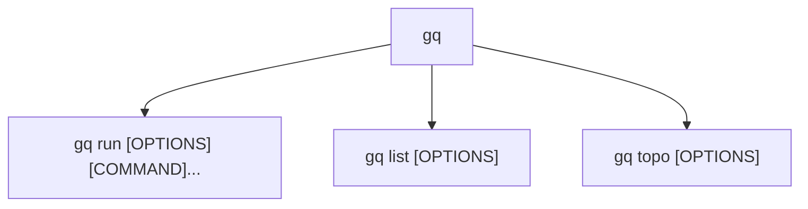

# CLI reference

```text
gq [GLOBAL OPTIONS] <COMMAND>
```

## Command tree



## Global options

| Option | Default | Meaning |
|---|---|---|
| `-v, --verbose` | Info | Increase log verbosity. Repeat for more detail: `-v` is Debug and `-vv` is Trace. |
| `-q, --quiet` | off | Disable all logging. Conflicts with `--verbose`. Data still prints. |
| `-h, --help` | | Print help. |
| `-V, --version` | | Print the version. |

`--verbose` and `--quiet` are global and may appear before or after the
subcommand. `RUST_LOG` is honored unless `--quiet` is set.

## gq run

```text
gq run [OPTIONS] [COMMAND]...
```

| Option | Default | Meaning |
|---|---|---|
| `-i, --include <A,B-C,...>` | all cards | Keep only card indices in the listed inclusive ranges. Conflicts with `--exclude`. |
| `-x, --exclude <A,B-C,...>` | none | Drop card indices in the listed inclusive ranges. Conflicts with `--include`. |
| `--max-vram <SIZE_OR_PERCENT>` | 100 MiB used | Require used VRAM to be at most the threshold. Conflicts with `--min-vram`. |
| `--min-vram <SIZE_OR_PERCENT>` | unset | Require free VRAM to be at least the threshold. Conflicts with `--max-vram`. |
| `--max-utilization <PERCENT>` | unset | Require utilization to be at most the threshold. Alias: `--max-util`. |
| `--probe-count <COUNT>` | 1 | Number of samples per probe round, one second apart. Alias: `--probe-cnt`. |
| `-k, --count <COUNT>` | 1 | Number of cards to select. |
| `--strategy <STRATEGY>` | `first` | Card ordering: `first`, `min-used`, or `topology-aware`. |
| `--poll <SECONDS>` | 60 | Interval between probe rounds. |
| `--timeout <SECONDS>` | 0 | Exit 75 after this many seconds of waiting. Zero waits forever. |
| `--no-wait` | off | Make one probe round and do not wait between rounds. Conflicts with explicit `--poll` or `--timeout`. Alias: `--no-waiting`. |
| `--dir <DIRECTORY>` | current directory | Change directory before running the command. Aliases: `--change-directory`, `--cd`. |
| `-e, --env <KEY=VALUE>` | none | Set an environment variable for the child. Repeatable. |
| `--dry-run` | off | Probe and select once, print the decision, and do not run a command. |
| `COMMAND...` | | Program and arguments. Optional only with `--dry-run`. |

The command is executed directly, without a shell. Use `sh -c '...'` when shell
syntax is needed. `CUDA_VISIBLE_DEVICES` and `GQ_CARDS` are reserved and are set
by `gq` on the child.

Filter semantics are described in [filters.md](filters.md). Wait and execution
semantics are described in [run.md](run.md).

## gq list

```text
gq list [OPTIONS]
```

`gq list` probes the cards and prints their current status. It accepts the same
filter options as `gq run` (`--include`, `--exclude`, `--max-vram`,
`--min-vram`, `--max-utilization`, and `--probe-count`). A card that passes the
idle predicate is marked `Available`; the others are marked `In use`.

| Option | Default | Meaning |
|---|---|---|
| `-f, --format <FORMAT>` | `pretty` | Output format: `pretty`, `json`, or `csv`. |

## gq topo

```text
gq topo [OPTIONS]
```

`gq topo` queries `nvidia-smi topo -m` and prints the link matrix. With one GPU
it warns that the topology cannot be determined and exits 0.

| Option | Default | Meaning |
|---|---|---|
| `-f, --format <FORMAT>` | `pretty` | Output format: `pretty`, `json`, or `csv`. |

## Output formats

`gq list` output has the columns or fields `index`, `memory_total_mib`,
`memory_used_mib`, `memory_free_mib`, `utilization_percent`, and `status`.

- `pretty` prints a table.
- `json` prints a compact JSON array of objects.
- `csv` prints a header row followed by one row per card.

`gq topo` describes pairwise links. The pretty matrix and JSON include both
directions for each pair; CSV lists each unordered pair once.

- `pretty` prints a matrix with `H`, `M`, and `L` quality letters. On a terminal
  it uses color unless `NO_COLOR` is set.
- `json` prints a nested object keyed by card, with `link` and `quality` fields
  for every other card. The diagonal is omitted.
- `csv` prints the columns `card a`, `card b`, `link`, and `quality`.

`gq run` has no format option. Logs go to stderr. A dry-run decision goes to
stdout. A running child inherits gq's standard input, output, and error.

## Exit codes

| Code | Meaning |
|---|---|
| 0 | Success, including help and version output. |
| 1 | Internal or configuration error; probe error in `gq list`, `gq topo`, or `--dry-run`; no cards reported; topology matrix disagrees with the usage probe; working directory disappeared before spawn. |
| 64 | Usage error, such as an unknown flag, invalid value, impossible filter, or missing command without `--dry-run`. |
| 75 | Transient failure: no matching idle GPUs in a single round, no idle match in `--dry-run`, timeout expired, or probe failure under `--no-wait`. Retry later. |
| 126 | Permission denied for the command or working directory, or the file is not a valid executable format. |
| 127 | Command or its `#!` interpreter was not found. |
| 128+n | Terminated by signal `n` (for example 143 is SIGTERM). `gq` also returns this when it forwarded the signal to the child. |
| other | A child exit code not covered above, 0 through 255. |

## Logging

Logs are written to stderr with timestamps and levels. Data and decisions are
written to stdout.

- Default level is Info: idle thresholds, wait reasons, starting cards, and
  warnings about degraded or contradictory requests. The effective candidate
  scope is logged at Info when `--include` or `--exclude` is set.
- `-v` enables Debug: excluded indices, the unfiltered `N/N` candidate count,
  per-GPU idle decisions with the computed threshold, selection ranking and
  topology target tuples, and the next probe delay with the remaining timeout.
- `-vv` enables Trace, including full `nvidia-smi` output.
- `-q` disables logging entirely.
- `RUST_LOG` can override the level unless `-q` is used.
- Color is used only when stderr is a terminal and `NO_COLOR` is unset.

Repeated wait rounds keep the same state at Debug; Info is reserved for the
first wait and for changes in the reason. A `--probe-count` above 60 warns once
about the cost of sampling; a count whose one-second intervals cannot fit in
`--timeout` also warns once, naming `--timeout` or `--probe-count` as the fix.
Unhandled errors print `Error: ...` to stderr unless `--quiet` is set.

## Completion and man page

A build generates static shell completion scripts under
`target/<profile>/completions` and a man page at `target/<profile>/man/gq.1`.
The profile is `debug` for a normal build and `release` for
`cargo build --release`. Install examples:

```sh
install -Dm644 target/release/completions/gq.bash ~/.local/share/bash-completion/completions/gq
install -Dm644 target/release/completions/gq.fish ~/.config/fish/completions/gq.fish
install -Dm644 target/release/man/gq.1 ~/.local/share/man/man1/gq.1
```

For zsh, place `_gq` from the completions directory in a directory on `$fpath`.
Run `mandb` if new man pages are not found automatically.

Dynamic completion needs no generated files:

```sh
# bash
source <(GQ_COMPLETE=bash gq)

# zsh
source <(GQ_COMPLETE=zsh gq)

# fish
GQ_COMPLETE=fish gq | source
```

Static scripts are a snapshot of the CLI taken at build time. They are
self-contained and add little to shell startup, but they must be reinstalled
after an upgrade. Dynamic completion emits shell code that calls the installed
binary while completing. It stays in sync with that binary and needs no install
step, at the cost of invoking `gq` during completion. Put the `source` line in
your shell startup file so the generated shell code is refreshed on each shell.
