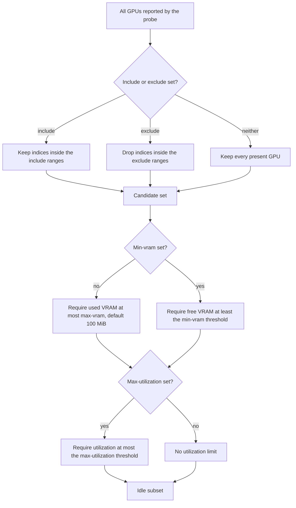

# Filters and idle detection

Selection has two stages. The candidate predicate decides which card indices are allowed.
The idle predicate decides which of those cards currently have enough free memory and little enough utilization.
Both stages must pass.
The predicates are shared by `gq run` and `gq list`.

## Flow



## Candidate predicate

`--include` and `--exclude` accept comma-separated inclusive ranges.
A single index such as `3` means only card 3, and a range such as `2-5` means cards 2, 3, 4, and 5.
For example, `--include 0,2-4` keeps cards 0, 2, 3, and 4.

- With no include or exclude option, every card reported by the probe is a candidate.
- `--include` keeps only indices inside at least one listed range.
- `--exclude` drops indices inside any listed range.
- `--include` and `--exclude` cannot be combined. Passing both is a usage error.

The filter is checked against the cards that actually exist.
A range that mentions an absent card produces a warning, not an error.
For example, with cards 0 and 2 present, `--include 0-7` warns that the range mentions absent cards and still selects from 0 and 2.
`gq run` emits this warning on its first successful probe.
`gq list` emits it for the listing.

If no present card matches the candidate predicate, `gq list` exits 1.
`gq run` exits 64 when its first successful probe yields an empty or too-small candidate set.
Once a probe has succeeded with enough candidates, a later shortfall waits instead, as described in [run.md](run.md#probe-failures-and-candidate-shrink).

## Idle predicate

The idle predicate combines a memory threshold and an optional utilization
threshold. Both must pass.

| Flag                         | Default      | Test                                                              |
| ---------------------------- | ------------ | ----------------------------------------------------------------- |
| `--max-vram SIZE_OR_PERCENT` | 100 MiB used | Used VRAM is at most the threshold.                               |
| `--min-vram SIZE_OR_PERCENT` | unset        | Free VRAM is at least the threshold. Conflicts with `--max-vram`. |
| `--max-utilization PERCENT`  | unset        | Utilization is at most the threshold. Alias: `--max-util`.        |

The 100 MiB default applies only when neither `--max-vram` nor `--min-vram` is given.
If only `--max-utilization` is given, the 100 MiB used-memory limit still applies.
If `--min-vram` is given, it replaces the used-memory test with a free-memory test.
Bounds are inclusive.

Sizes are binary and case-insensitive: `K`, `M`, `G`, and `T` mean KiB, MiB, GiB, and TiB, with optional `B` or `iB` suffixes.
A size without a suffix is in MiB.
A percentage is a share of the card's total VRAM.
For `--max-vram` it caps used memory; for `--min-vram` it sets the required free share.

## Probe aggregation

`--probe-count` controls how many samples are taken, one second apart. The default is 1.
Per card, the samples are combined as follows:

- Used VRAM is the maximum.
- Free VRAM is the minimum.
- Utilization is the mean.
- Total VRAM must be unchanged between samples.

The set of card indices must also be identical between samples.
If the set changes, the probe round is discarded and immediately sampled once more.
A count above 60 logs a warning because the samples take about one second each.

## Logging

`gq run` and `gq list` use the same filter logging.
On the first successful probe, Info reports the idle rule and, when `--include` or `--exclude` is set, the effective candidate scope:

```text
candidates: 6/8 GPUs (--include 0-5)
idle rule: free VRAM >= 8.0 GiB; utilization <= 5%
```

Without `--include` or `--exclude`, the `N/N` candidate count moves to Debug because it adds no information.
Info requires `-v` and Debug requires `-vv`; the default Warn level only shows warnings and errors.

The default 100 MiB used-memory limit is only named when it is in effect.
At Debug, every candidate is reported as idle or not idle with the tested value and the limit actually applied.
Percentage limits are converted per card, so the byte threshold is visible:

```text
GPU1: not idle: used VRAM 1024 MiB > 100 MiB
GPU2: idle (used 5 MiB <= 100 MiB, util 3%)
GPU3: not idle: used VRAM 1024 MiB > 491 MiB, 1% of total
```

Indices removed by `--include` or `--exclude` are listed at Debug.
Ranges that mention absent cards still warn as described above.

## Filters do not reserve cards

Filtering and probing only observe the cards.
They do not lock, claim, or reserve anything.
Another process can start on a card between the probe and the spawn.
Two concurrent `gq` invocations can also select the same idle cards.
Use a scheduler such as `pueue` when jobs must not overlap.
