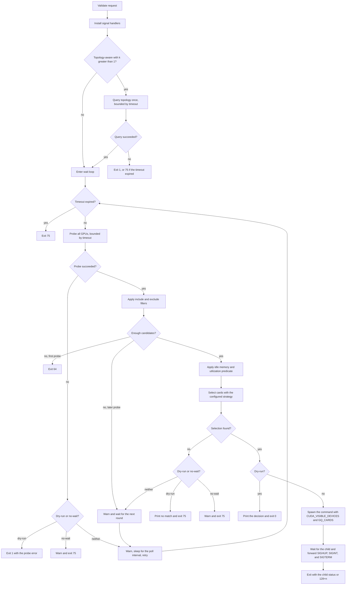

# Run lifecycle

`gq run` validates the request, probes the cards, selects a group, and runs one command with the selected card indices in `CUDA_VISIBLE_DEVICES` and `GQ_CARDS`.
Selection is advisory: probing does not reserve anything.

## Flow

## Validation

The request is checked before the first probe:

- Without `--dry-run`, a command is required.
- The command's program name must not be empty.
- `--dir` must name an existing directory.
- `--env` must not set `CUDA_VISIBLE_DEVICES` or `GQ_CARDS`, which `gq` sets for the child.
- `--probe-count` sampling should fit in a non-zero `--timeout`; a count that cannot finish logs a warning before probing.

A validation failure is a usage error and exits 64.
The directory is checked again by the operating system at spawn time, so a directory that disappears after validation produces exit 1.

## Topology query

With `--strategy topology-aware` and `-k` greater than 1, `gq` runs `nvidia-smi topo -m` once before the wait loop.
The query shares the timeout budget and each `nvidia-smi` call is capped at 10 seconds or the remaining budget, whichever is shorter.

The topology query is not retried.
A failure exits 1, unless the timeout has already expired, in which case it exits 75.
If a candidate card index is outside the topology matrix, `gq` treats the two `nvidia-smi` outputs as inconsistent and exits 1.

With `-k 1`, topology-aware selection warns and degenerates to the first idle card, suggesting `-k 2` or more or `--strategy first`.
No topology query is made because a single card has no pairs to score.

## Probing

Each probe round samples every GPU `--probe-count` times, one second apart.
A single `nvidia-smi` call is killed after 10 seconds or when the timeout expires.
`GQ_NVIDIA_SMI` overrides the probe program, which defaults to `nvidia-smi`.

Samples are aggregated per card:

- Used VRAM is the maximum across samples.
- Free VRAM is the minimum across samples.
- Utilization is the mean across samples.
- Total VRAM must be identical across samples.

The card set must also be identical across samples.
If it changes, the whole round is discarded and sampled once more immediately.
That immediate retry is a bound against an unstable driver state, not an extra wait attempt.
If the retry also produces an inconsistent set, the error is handled like any other probe failure.
Probe counts above 60 warn once because they take roughly one second per extra sample and are rarely useful.
A probe count whose one-second intervals cannot fit in the timeout also warns before the first probe.

## Wait loop

The timeout is a wall-clock budget that starts before the optional topology query.
It bounds the topology query, every `nvidia-smi` call, and the sleep between probe rounds.
The sleep is the poll interval capped by the remaining budget, and it is interrupted by a signal.
The timeout does not limit how long the selected command runs once it has started.

| Flag                | Default | Behavior                                                                                              |
| ------------------- | ------- | ----------------------------------------------------------------------------------------------------- |
| `--poll SECONDS`    | 60      | Interval between probe rounds.                                                                        |
| `--timeout SECONDS` | 0       | Exit 75 after this many seconds of waiting. Zero waits forever.                                       |
| `--no-wait`         | off     | Make one probe round and do not wait between rounds. Conflicts with explicit `--poll` or `--timeout`. |
| `--dry-run`         | off     | Make one selection attempt, print the decision, and exit without running a command.                   |

`--no-wait` still reports an impossible request as 64, because candidate validation happens before idleness is considered.
If the one round succeeds but no idle group is available, or the probe itself fails, it exits 75.

Idle and candidate wait states are deduplicated: the first occurrence and every change log at Info, repeated rounds with the same state log at Debug, and a candidate shortfall after the first successful probe logs at Warn.
A probe failure is a separate event and warns on every round, so a flaky probe stays visible.
Each Debug round also reports the next probe delay and the remaining timeout budget with one decimal, so a long wait is traceable without repeating the same Info line every poll.
Info requires `-v` and Debug requires `-vv`; the default Warn level only shows warnings and errors.

When `--strategy topology-aware` misses because the best-connected group is busy, the Info or `--no-wait` warning names the topology target mismatch instead of reporting an idle shortage, and suggests `--strategy first` or waiting for a compatible group.
`--dry-run` keeps its stdout line `no GPUs match the current constraints` and explains the mismatch on stderr.

`--dry-run` is a single-shot mode.
It makes one probe and selection attempt, ignores `--poll`, and does not retry between rounds.
`--timeout` still bounds the probe and can produce 75.
On a successful probe it prints either `would run on GPUs 2,3` and exits 0, or `no GPUs match the current constraints` and exits 75.
A probe or topology failure exits 1, and an expired timeout exits 75.

## Probe failures and candidate shrink

When waiting normally, a failed probe logs a warning and retries after the poll interval.
The timeout continues to apply.
With `--no-wait`, a probe failure exits 75; with `--dry-run`, it exits 1.

Candidate validation happens on the first successful probe.
If no card matches the filter, or fewer than `-k` cards match, `gq` exits 64 as an impossible request.
A failed probe does not count as the first successful probe, so this decision can happen on a later attempt.

After the first successful probe, the same candidate shortfall is not treated as a usage error.
`gq` logs a warning and waits for the next round, because the set of present cards can change between probes.
It does not reduce `-k` automatically.
If a probe reports no cards at all, `gq` exits 1 because there is nothing to wait for.

## Execution

The command is spawned directly, without a shell.
`gq` passes any `--env` assignments, changes to `--dir`, and sets `CUDA_VISIBLE_DEVICES` and `GQ_CARDS` to the selected indices in ascending order.
Standard input, output, and error are inherited by the child.

While the child runs, `gq` waits in short slices and forwards SIGHUP, SIGINT, and SIGTERM.
If a forwarded signal is accepted, `gq` exits 128 plus that signal number.
Otherwise it exits with the child's own status, including 128 plus the signal number when the child was killed by a signal.

Exit codes are listed in [cli.md](cli.md#exit-codes).
