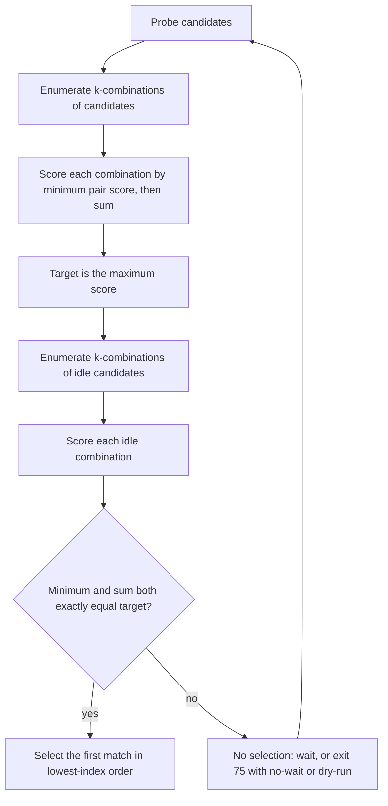

# Topology-aware selection

Topology-aware selection prefers groups of cards with strong pairwise links. It
uses the matrix printed by `nvidia-smi topo -m`, scores each pair, and compares
whole `-k` groups rather than sorting cards individually.

## Flow



## Link scores

Each pair of distinct cards has a `LinkType` parsed from the topology matrix.
The default score is a bandwidth term plus an inverse latency term:

```text
default_score = 1.0 * relative_bandwidth + 1.0 / relative_latency
```

| Link | Relative bandwidth | Relative latency | Default score | Quality |
|---|---|---|---|---|
| `SYS` | 0.10 | 6.0 | 0.267 | Low |
| `NODE` | 0.20 | 3.0 | 0.533 | Medium |
| `PHB` | 0.22 | 2.2 | 0.675 | Medium |
| `PXB` | 0.25 | 1.8 | 0.806 | Medium |
| `PIX` | 0.25 | 1.5 | 0.917 | Medium |
| `NVLink(n)` | 0.25n | 1.0 | 0.25n + 1.0 | High |

Quality is a coarse display classification: High at 1.0 or above, Medium at 0.4
or above, and Low below 0.4. Ranking uses the raw score, not the quality label.
The diagonal `X` entry is a self link with a nominal score, but a combination
never includes a card paired with itself, so self scores are ignored.

## Combination score

For a group of `k` cards, `gq` scores every unordered pair in the group and
combines the results into a tuple:

```text
(minimum pairwise score, sum of pairwise scores)
```

The target is the maximum of this tuple over every `k`-combination of the
candidate set, using lexicographic comparison: the minimum pair score dominates,
and the sum breaks ties. The target is computed from all candidates, including
busy cards, before idleness is considered.

A combination of one card has no pairs. `-k 1` is handled separately: it selects
the first idle card and warns that topology-aware has no effect, suggesting
`-k 2` or more or `--strategy first`. No topology query is made.

## Eligibility and ties

Only combinations made entirely of idle cards are eligible. An eligible
combination must match the target tuple exactly, meaning both the minimum pair
score and the sum are equal. There is no fallback to a lower-scoring group.

If several idle combinations have exactly the target score, the first one in
ascending index order is selected. Since idle indices are sorted and
combinations are generated in that order, this is the lowest-index combination.

At Debug, `gq` logs the candidate target tuple and then either the selected
combination or that no idle combination matched it. Debug requires `-vv`, and
the Info wait message requires `-v`; the default Warn level only shows warnings
and errors. A mismatch is not a fallback: it waits for a later probe, exits 75
under `--no-wait`, or prints the no-match message under `--dry-run`. The wait
message at Info and the `--no-wait` warning name the topology target rather than
an idle shortage, and suggest `--strategy first` or waiting for a compatible
group. `--dry-run` keeps its stdout line `no GPUs match the current constraints`
for scripts and explains
the target mismatch on stderr.

The target is recomputed on every probe round from the candidates that remain.
The topology matrix itself is queried once at startup. If a candidate index is
outside the matrix, `gq` treats the topology and usage outputs as inconsistent
and exits 1.

## Worked example

Four cards, a topology-aware run with `-k 2`, are present. GPUs 0 and 1 are
connected by `NV8`; every other pair is connected by `SYS`.

| Pair | Link | Score |
|---|---|---|
| 0-1 | `NV8` | 3.000 |
| 0-2, 0-3, 1-2, 1-3, 2-3 | `SYS` | 0.267 |

The candidate combinations are `0-1` with score `(3.000, 3.000)` and the other
five pairs with score `(0.267, 0.267)`. The target is `(3.000, 3.000)`.

- If cards 0 and 1 are idle, `gq` selects them.
- If either card 0 or card 1 is busy, no idle combination matches the target.
  This remains true even when cards 2 and 3 are both idle, because their `SYS`
  pair scores lower than the target. `gq` waits for 0 and 1 instead of falling
  back.
- With `--no-wait`, that round exits 75. With `--dry-run`, it prints that no
  GPUs match the current constraints and exits 75.

If a candidate disappears entirely, for example because card 0 stops being
reported, the target is recomputed over the remaining candidates. A run that
previously required the 0-1 pair can then accept the best remaining pair.
