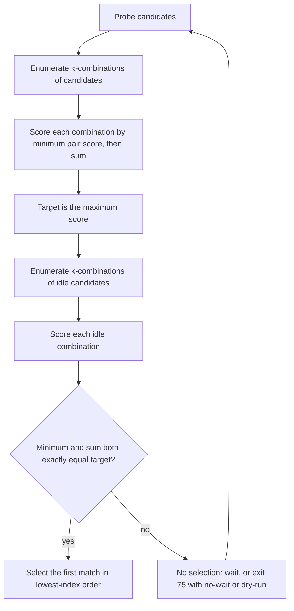

# Topology-aware selection

Topology-aware selection prefers groups of cards with strong pairwise links.
It uses the matrix printed by `nvidia-smi topo -m`, scores each pair, and compares whole `-k` groups rather than sorting cards individually.

## Flow



## Link scores

Each pair of distinct cards has a `LinkType` parsed from the topology matrix.
Each class has a one-direction bandwidth in GB/s and an end-to-end peer-to-peer latency in microseconds.
The score is a weighted bandwidth term plus a weighted inverse latency term:

```text
score = w_b * bandwidth_gbps / 100 + w_l / latency_us
```

The default weights are `w_b = 1.0` and `w_l = 1.0`.
The 100 GB/s reference keeps the default scores bit-for-bit identical to the earlier unitless priors.

| Link        | Bandwidth (GB/s) | Latency (us) | Default score | Quality |
| ----------- | ---------------- | ------------ | ------------- | ------- |
| `SYS`       | 10               | 6.0          | 0.267         | Low     |
| `NODE`      | 20               | 3.0          | 0.533         | Medium  |
| `PHB`       | 22               | 2.2          | 0.675         | Medium  |
| `PXB`       | 25               | 1.8          | 0.806         | Medium  |
| `PIX`       | 25               | 1.5          | 0.917         | Medium  |
| `NVLink(n)` | 25n              | 1.0          | 0.25n + 1.0   | High    |

The NVLink bandwidth is per link, and a bonded `NVLink(n)` multiplies it by `n`; latency does not scale with the link count.
Quality is a coarse display classification: High at 1.0 or above, Medium at 0.4 or above, and Low below 0.4.
Quality labels always use the built-in priors, never the calibration profile.
Ranking uses the raw score, not the quality label.
The diagonal `X` entry is a self link with a nominal score, but a combination never includes a card paired with itself, so self scores are ignored.

## Calibration

`gq` does not measure hardware.
It reads an optional config file and applies the values to topology-aware selection; measuring the links is an external workflow.

### Config file

The config lives at `$XDG_CONFIG_HOME/gq/config.toml`, falling back to `$HOME/.config/gq/config.toml`.
If `XDG_CONFIG_HOME` is set but empty or relative, `gq` falls back to `HOME`; if neither variable yields an absolute directory, the built-in priors are used.
A missing file is not an error.
Unknown keys and invalid values are errors that name the file and field.

Every key is optional.
The following example shows all keys and their default values:

```toml
[link.bandwidth]   # one-direction GB/s; nvlink is per link, NVLink(n) multiplies by n
sys = 10
node = 20
phb = 22
pxb = 25
pix = 25
nvlink = 25

[link.latency]     # microseconds, end-to-end P2P; nvlink is per link
sys = 6
node = 3
phb = 2.2
pxb = 1.8
pix = 1.5
nvlink = 1.0

[link.score]
bandwidth = 1.0
latency = 1.0
```

A partial override such as `[link.bandwidth]` with `sys = 8.5` changes only `SYS`; every omitted key keeps its default.
Bandwidth and latency values must be finite and greater than zero.
Weights must be finite and non-negative, and at least one weight must be non-zero.

The profile is read only by `--strategy topology-aware` with `-k` greater than 1.
Other strategies and `-k 1` never read the config file.
Quality labels in `gq topo` and the default score table above still use the built-in priors; calibration changes ranking only.

### Measuring with nvbandwidth

[NVIDIA nvbandwidth](https://github.com/NVIDIA/nvbandwidth) v0.5 or later reports per-pair device-to-device results, including latency.
Run it on idle, exclusively allocated GPUs; other work on the cards or the fabric distorts the numbers.

- Use `device_to_device_memcpy_read_ce` and `device_to_device_memcpy_write_ce` for bandwidth.
  Each reports one direction; for a pair, take the lower of the two directions.
- Use `device_to_device_latency_sm` for end-to-end peer-to-peer latency.
  It reports nanoseconds; divide by 1000 to get microseconds.
- `nvbandwidth -l` lists the available test keys.

Verify the row and column orientation from the output header before copying numbers.
Reduce each pair to the minimum of its two directions, then take the median per link class.
Do not overfit: two significant digits are enough, and keep the score weights coarse unless you have evidence for a sharper ratio.

### Alternative: cuda-samples

`p2pBandwidthLatencyTest` from [cuda-samples](https://github.com/NVIDIA/cuda-samples) v12.8, under `Samples/5_Domain_Specific`, prints bandwidth in GB/s and latency in microseconds for every pair.
It covers the same ground as the nvbandwidth tests above.

### Mapping pairs to classes

`nvidia-smi topo -m` prints the class of every pair: `SYS`, `NODE`, `PHB`, `PXB`, `PIX`, or `NVn`.
Group the measured pairs by that label and reduce each class to one bandwidth and one latency value.
For an `NVn` pair, write the per-link value: divide the measured pair bandwidth by `n`. The latency does not scale with `n`.

The CPU-path classes must be measured end-to-end, with the same copies or kernel launches that the workload uses.
CPU-only tools are proxies at best: `numactl` distances, cross-socket `mbw` or STREAM numbers, and PCIe generation and width describe parts of the path, not a GPU-to-GPU result.
NUMA distance is a relative number and is not GB/s or microseconds; do not put it in this file.

### Limits

The model scores pairs independently.
It does not capture aggregate contention when a collective or many concurrent transfers share the fabric, nor does it model switch oversubscription.
Treat the profile as a ranking aid, not a performance prediction.
`gq` never runs a benchmark; all measurements happen outside it.

## Combination score

For a group of `k` cards, `gq` scores every unordered pair in the group and combines the results into a tuple:

```text
(minimum pairwise score, sum of pairwise scores)
```

The target is the maximum of this tuple over every `k`-combination of the candidate set, using lexicographic comparison: the minimum pair score dominates, and the sum breaks ties.
The target is computed from all candidates, including busy cards, before idleness is considered.

A combination of one card has no pairs.
`-k 1` is handled separately: it selects the first idle card and warns that topology-aware has no effect, suggesting `-k 2` or more or `--strategy first`.
No topology query is made.

## Eligibility and ties

Only combinations made entirely of idle cards are eligible.
An eligible combination must match the target tuple exactly, meaning both the minimum pair score and the sum are equal.
There is no fallback to a lower-scoring group.

If several idle combinations have exactly the target score, the first one in ascending index order is selected.
Since idle indices are sorted and combinations are generated in that order, this is the lowest-index combination.

At Debug, `gq` logs the candidate target tuple and then either the selected combination or that no idle combination matched it.
Debug requires `-vv`, and the Info wait message requires `-v`; the default Warn level only shows warnings and errors.
A mismatch is not a fallback: it waits for a later probe, exits 75 under `--no-wait`, or prints the no-match message under `--dry-run`.
The wait message at Info and the `--no-wait` warning name the topology target rather than an idle shortage, and suggest `--strategy first` or waiting for a compatible group.
`--dry-run` keeps its stdout line `no GPUs match the current constraints` for scripts and explains the target mismatch on stderr.

The target is recomputed on every probe round from the candidates that remain.
The topology matrix itself is queried once at startup.
If a candidate index is outside the matrix, `gq` treats the topology and usage outputs as inconsistent and exits 1.

## Worked example

Four cards, a topology-aware run with `-k 2`, are present.
GPUs 0 and 1 are connected by `NV8`; every other pair is connected by `SYS`.

| Pair                    | Link  | Score |
| ----------------------- | ----- | ----- |
| 0-1                     | `NV8` | 3.000 |
| 0-2, 0-3, 1-2, 1-3, 2-3 | `SYS` | 0.267 |

The candidate combinations are `0-1` with score `(3.000, 3.000)` and the other five pairs with score `(0.267, 0.267)`.
The target is `(3.000, 3.000)`.

- If cards 0 and 1 are idle, `gq` selects them.
- If either card 0 or card 1 is busy, no idle combination matches the target. This remains true even when cards 2 and 3 are both idle, because their `SYS` pair scores lower than the target. `gq` waits for 0 and 1 instead of falling back.
- With `--no-wait`, that round exits 75. With `--dry-run`, it prints that no GPUs match the current constraints and exits 75.

If a candidate disappears entirely, for example because card 0 stops being reported, the target is recomputed over the remaining candidates.
A run that previously required the 0-1 pair can then accept the best remaining pair.
